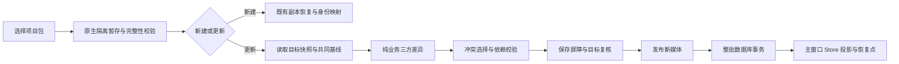

# 项目导入更新与三方合并方案

> 日期：2026-10-30
> 状态：2026-10-31 已写入 P0–P3 核心链路与回归材料；未运行测试、类型检查、构建或桌面验收。提交时仅执行定向 ESLint，结果以实际提交记录为准。
> 所属模块：[文件与存储](../文件与存储模块.md)；架构取舍：[ADR-0011](../adr/0011-project-archive-three-way-merge.md)。

## 1. 目标与已确认范围

用户需要通过项目包往返协作：导入时可以选择更新本机已有项目；双方修改不同内容时合并；修改冲突时，由用户选择“保留我的”或“采用对方的”。

用户已确认第一版合并画布、分集、项目设置和项目资产；聊天与项目记忆可选追加，并已于 2026-10-30 授权按本方案分阶段实施。具体实现边界按下方阶段状态记录。

- 保留“导入为新项目”，默认不覆盖任何已有项目。
- “更新已有项目”保留目标项目及已匹配分集的本机 ID、数据目录和现有引用。
- 首版按整部剧 owner 对账，覆盖其分集；普通项目按单项目处理。分集只维护自己的画布与剧本，共用资产仍只写 owner。
- 不提供实时共编、后台自动合并、按最后修改时间覆盖、AI 自动裁决冲突、通用版本管理界面。
- 本机撤销历史、计费账本和独立运行队列不迁移；节点当前产物及项目包实际纳入的业务素材按本方案处理，不把磁盘上存在某张图片当作已有完整生成历史。
- 不通过本功能执行生成、插件代码、Skill、工具、远端任务或导入的运行队列。

## 2. 方案制定时的入口与缺口（实际进度见第 11 节）

| 已核对入口 | 当前行为 / 对方案的影响 |
|---|---|
| `src/services/projectTransferService.ts` | 当前归档 v2，包含项目、分集、对话、记忆与素材；导入生成新的项目/分集 ID，清除源机器文件身份。清单无协作来源和共同版本记录。 |
| `src/store/store.projects.ts` | 导入结果直接追加项目列表；复制项目复用归档恢复流程。已有按项目保存队列与共享资产库提交屏障。 |
| `src/services/storageService.ts` | `ProjectSaveData` 持久化画布、设置、分集、剧集与资产；加载会恢复本地媒体 URL，不宜拿运行期对象直接比较。 |
| `src/services/indexedDbService.ts` / `indexedDb/schema.ts` | 项目与摘要落库；方案建立时为 v26，本批升至 v27 仅补协作表。更新一整部剧的整批事务与持久化写入 epoch 尚待 P2。 |
| `src-tauri/src/files/project_archive.rs` | 现有解包会直接把素材写入指定目录，不能把已有项目目录作为合并预览的解包目标；需先隔离暂存。 |
| `src/components/ProjectLibraryModal.tsx` | 当前选择项目包后直接导入，需加入模式选择、目标选择、预览及冲突处理。 |
| `src/services/canvasDerivationGuard.ts` | 可复用异步项目/revision 保护，但内存 revision 不能代替跨实例的数据库提交条件。 |

节点与卡片 ID 在归档中可能仍相同，不等于已有可信的项目来源、双方改动历史或共同基线。同名、镜号、文件名、更新时间和内容哈希都不能单独证明“这是同一个逻辑实体”。

现有 S3 功能只同步项目资产，不合并画布。归档更新不复制另一台机器的云绑定、连接凭据、已接受远端版本、同步待办或运行租约。

## 3. 用户操作流程

### 3.1 选择导入方式与目标

选择 `.aicanvas` 后，先读取并校验隔离暂存材料，展示项目名称、分集数量、素材数量及包的兼容状态：

1. **导入为新项目**：延续现有副本导入；新建本机 ID 与目录。
2. **更新已有项目**：选择本机目标项目/整部剧，再进入对比；不得根据同名静默选中或写入。

存在可靠协作来源时优先列出对应候选；存在多个本机副本时仍由用户选择。没有对应目标时可返回新建导入。可明确选择“作为独立副本”开始新的协作来源；应用内“复制项目”默认也开始新来源，避免把独立副本误当成同一协作分支。

目标关联错误、整部剧/普通项目结构不匹配时停止自动匹配，回到目标选择，不按数组下标拼接分集。

### 3.2 预览变更

展示“可自动合并 N 项、冲突 N 项、需处理的依赖 N 项”，按“项目设置 → 分集/剧本 → 画布 → 创作资产 → 文件”组织。未变化内容默认折叠。

- 文本采用左右差异展示；“共同版本”可展开查看。
- 图片展示缩略图与变化字段；视频/音频按需预览，不自动播放。
- 节点展示名称、所属分集、类型与变化字段；位置变化与提示词变化分开说明。
- 只读取暂存内容和目标快照；取消不创建可见项目、不修改原项目或本地素材。
- 预览使用只读文本/媒体展示，不挂载可能发起生成、加载外部代码或恢复任务的业务节点、插件 WebView。
- 预览期间允许继续编辑。目标相关内容变化后显示“内容已变化，请重新对比”；确认前必须重新检查，旧选择只可复用到基线、双方值和依赖均未变化的冲突。

### 3.3 处理冲突

每个冲突明确列出“共同版本 / 我的当前内容 / 对方内容”，提供：

- **保留我的**：保留本地值，包括本地已经删除的情况。
- **采用对方的**：采用包内值，包括经确认的逻辑删除。
- 允许对当前筛选范围批量选择，并显示影响数量；应用前可以改回。
- 不默认替用户选定某一侧，不因更新时间更晚自动勾选。
- 首版不增加“保留两份”的实体分叉语义；不同逻辑身份的新节点本来就各自保留。

选择产生悬空连线、缺失引用、无效主图或循环分组时，转成关联依赖冲突并继续处理。不能为了通过校验而静默补回已删除节点、丢弃连线或剥掉引用。

全部业务变化都必须有明确结果，才启用“应用更新”。首版不提供任意跳过若干分集却把整个对方版本标记为已合并的操作；选择保留本地等于明确拒绝对方相应改动。

### 3.4 应用结果

确认页列出新增、修改、逻辑删除、冲突选择和可选历史追加数量，说明会保留合并前恢复点。提交成功后刷新原目标项目，不新建同名工作副本；可跳转到变化节点，并提示未绑定的本机模型/工作流。

导入同一版本第二次不重复创建节点、文件或历史副本；本机后来有新编辑也不因重复导入旧包而被回退。重新接受旧版本属于显式恢复，不能伪装成一次新合并。

## 4. 三方合并规则

令 B 为经核对的共同版本，L 为本机最新业务快照，R 为项目包中的业务快照。比较的是规范业务内容，不是运行期 URL 或时间戳。

| 与 B 相比 | 合并结果 |
|---|---|
| L、R 都未改 | 保持原值 |
| 仅 L 改动 | 保留本地 |
| 仅 R 改动 | 采用对方 |
| L、R 改成同一值 | 自动合并为该值 |
| L、R 改成不同值 | 冲突，由用户选择 |
| 一方删除、另一方仍与 B 相同 | 接受逻辑删除，再检查依赖 |
| 一方删除、另一方修改 | 删除/修改冲突 |
| 双方新增不同逻辑身份的实体 | 同时保留，不因同名合并 |
| 同一逻辑身份的新增内容不同 | 身份碰撞冲突，不猜测覆盖 |

例如：你改了节点位置，对方改了提示词，可以保留两项；双方都改提示词则二选一；一方删除节点而另一方新增指向它的引用，必须处理依赖冲突。

只有 B/L/R 对同一业务范围的材料均完整且通过校验时，才能按“缺失”判断逻辑删除。旧包未包含、读取截断、版本不支持、暂时离线或未纳入范围的内容都不是删除证据。

### 4.1 比较粒度与原子组

不对整个 JSON 做无条件递归合并。各领域声明可比较字段、稳定集合身份、原子组及依赖：

| 内容 | 首版规则 |
|---|---|
| 节点名称、正文、提示词、独立开关 | 独立字段比较；一段提示词/剧本文本作为一个值，提供差异查看，首版不自动做行级拼接。 |
| 位置与分组归属 | `parentId + position + extent` 及相关坐标语义为一个原子组；宽高组合整体比较。避免把改父级与旧相对位置拼成错误坐标。 |
| 连线 | 按稳定身份比较，端点、端口与类型作为结构原子组；合并后复核端点存在与连接约束。 |
| 分组 | 分组节点与对应 `NodeGroup` 元数据保持一致；成员关系、父链与坐标联动，拒绝循环和悬空父级。 |
| 分镜表 | 镜头行按稳定 row ID 对账，不能按镜号或行号匹配；行内独立文本/摄影字段可分别比较，画面/视频绑定整体比较。行序双方均改变时单独冲突，不按位置逐格覆盖。 |
| 媒体结果 | 文件身份、内容版本、输出指针及关联预览作为原子组，不拼接两侧不相容的结果字段；不合并进行中任务状态。 |
| 人物/场景/道具 | 按稳定卡片身份；参考图、声音、动作、动作媒体按子项身份；主图、头像裁剪、主音色和武器绑定提交前校验引用闭包。 |
| 剧集/分集 | 稳定分集身份独立于本机 project ID；新增、删除、排序、重命名和文本分别处理，分集归属固定在选定 owner 内。 |
| 设置 | 画风文本、母图、提示词后缀、生成规格参与比较；设备模型/工作流绑定需要本机映射，不直接套用另一台机器的连接 ID。 |
| 导演/插件/复杂编辑数据 | 复用现有领域校验，先按完整业务对象比较，不混合原生 Job、Scene/Manifest、时间轴等内部绑定；无法安全恢复的对象显示不支持并阻止采用，不降级为可执行内容。 |
| 未识别字段/类型 | 保守作为不透明值处理；单侧变化可按完整值选择，双方变化不猜测内部结构；不支持的格式不得绕过领域校验。 |

无论单项还是批量选择，最终都校验 `@节点`、`@drama` 子项、分镜来源、制作节点、风格母图与媒体的完整依赖。引用使用结构化适配器，复用已知胶囊协议；不能全局字符串替换 ID。

## 5. 共同来源、版本与归档 v3

以下为协议设计；当前已落地的字段和存储见“当前实施状态”，未落地部分不能当作已有能力。

### 5.1 身份与版本

- **lineageId**：一组往返协作项目的来源身份；不使用名称代替。
- **逻辑实体 ID**：项目/分集、节点、连线、分组、卡片、子项、镜头行与逻辑文件的稳定身份。通过类型化 sidecar 映射到本机 ID，避免把机器身份直接当协作身份。
- **revisionId / parentRevisionIds**：不可变业务快照与父版本；导出和接收提交形成有向无环关系，不用导出时间判断祖先。
- **contentDigest / canonicalVersion**：规范内容摘要与规范化版本。忽略运行态、预览缓存、选择状态、测量值和无业务意义时间；保留文本、显式 null、用户排序及有效精度。
- **packageId / operationId**：识别包与本机一次应用操作，避免重试、回执丢失与重复导入制造副本。

同内容可复用媒体字节，不合并逻辑资产。明确的文件内容替换沿用相应逻辑文件身份；新生成的独立素材分配新身份，节点换图表现为媒体绑定变化，不能按节点、同名或字节猜测文件身份。普通复制节点/卡片、复制整个项目都按复制语义分配新的逻辑身份，不能意外共享映射。

### 5.2 v3 材料与基线选择

保留现有 `manifest.json / project.json / episodes.json / chat.json / assets/` 结构，新增协作元数据、规范基线与媒体校验清单：

- 清单声明归档与规范版本、来源身份、当前版本、受约束的父链和完整性。
- 当前业务数据与身份映射应能还原成唯一规范快照，不能让两个正文互相矛盾。
- 首次交接把导出快照作为交换锚点；接收方保存这个锚点，修改后再导出时保留来源与父链。
- 携带必要交换锚点的规范正文及有界祖先描述，不复制整套历史媒体。历史正文按内容摘要去重；现有归档数量、文本和展开大小限制继续生效。
- 选择双方都能证明且正文摘要一致的最近公共祖先作为 B；本机未导出的编辑作为 L 捕获，不能把“最近导入过的包”直接当作共同版本。
- 基线正文可来自本地不可变快照或包内锚点；只有 hash 和时间、没有正文或可信父链，不能进行自动三方比较。
- 父链缺失、超过边界、出现循环、不同规范无法转换或存在多个不可比较的公共基线时，暂停自动三方合并，要求补充材料或进入人工对比，不按“最新时间”猜一个。
- 导出失败不推进本地已交接锚点；成功发布包之后才登记导出结果。应用失败不推进已接受版本。

v3 导出也必须得到一致材料：先通过现有队列保存并捕获 owner/分集快照，再稳定读取本轮媒体，校验捕获期间业务写入版本及文件内容未变化；发生变化则重新捕获或明确失败。hash 对应实际入包字节，不能先计算旧文件摘要再打包新文件。输出先写本轮临时文件，完成校验后发布到用户选择的位置。不可变准备快照可先保存用于恢复，但“已成功交接”标记须等待文件发布完成，崩溃后不能猜测导出成功。

A 导出 B0 → B 修改并返回 R1 → A 的本地修改 L1 与 R1 合成 M1；M1 记录两侧父版本。A 再发给 B 时，B 可以用已保存的 R1 识别共同版本，保留尚未发给 A 的新修改。用户选择保留本地的字段也是 M1 中明确记录的决定，不能下次导入同包再弹一次。

归档版本与本地数据库版本分别迁移。v3 旧客户端按现有版本门禁拒绝，并提示升级，不能让旧客户端忽略协作字段后重新导出还声称保留了协作关系。

### 5.3 旧包和现有项目如何开始

| 情况 | 路径 |
|---|---|
| 可信同来源 v3，存在共同基线 | 正常三方合并。 |
| v1/v2 或来源关系丢失，但保留最初发出的包 | 允许补充该原包；用户确认目标与实体对应后建立明确的外部基线，标明来源为用户提供。内容校验、映射与依赖检查仍须通过。 |
| 没有共同基线，也没有原包 | 显示“无法判断谁改了什么”，进入保守双向人工对比；仅一侧存在的条目也需选择，不能推断新增或删除。 |
| 同名但不同来源 | 不自动关联；只能新建或显式进入人工关联流程。 |
| 已有同来源多个本机副本 | 用户选择目标，不能静默更新最近打开的一份。 |

旧包中的同 ID 可用于提出对应候选，不作为跨项目的自动身份授权。首次人工关联只建立未来身份，不伪造过去共同历史；双方实际接收并保存同一版本后，后续往返才有自动三方合并的依据。

## 6. 素材、引用与可选历史

### 6.1 媒体与项目文件

- v3 对纳入材料生成标准整文件 SHA-256、字节数、类型和稳定逻辑身份；由原生在稳定字节上生成/复核，不把现有链式 `contentDigest` 当成整文件 SHA-256。
- 不按文件名认定同一文件，不凭相同字节合并节点或卡片。目标同名不同内容时分配新受管文件名，保留双方原文件。
- 预览只使用本次操作的不透明暂存资源标识；外部相对路径不直接作为目标写入路径。
- 更新文件采用新路径和新内容身份，再重映射选定的节点、资产与文件记录；不覆盖原路径。新索引、标签、明确保存的图片提示词/参考附件与引用同事务提交。
- “删除”只删除逻辑对象/引用，文件保留到既有使用位置与回收流程；不在合并时删除磁盘文件、传播云删除或清理全局资产。
- 既有 S3 本机绑定保留；外部绑定、令牌、基线和待办不导入。同一逻辑文件更新确需调整本机映射指针时，在事务中复核并只更新本地关联，不伪造云端已接受摘要/ETag。后续 S3 同步重新对账。
- 全局/外部资产引用未物化、素材缺失、哈希不符或原生结果绑定不可迁移时必须明确说明；选择依赖不完整的对方内容不能标为完整更新。
- 本轮暂存、恢复材料、历史文件不参与普通资产扫描或下一次项目打包，不把恢复缓存反复导出。

### 6.2 聊天与项目记忆

用户已选择可选追加，默认不勾选，不进入画布业务三方合并：

- 勾选后以“对方导入记录”追加独立来源会话，不覆盖、删除或续接本机会话；消息保留顺序，并重映射会话/消息身份与来源。
- 同一来源版本的追加记录去重；本机删除后是否重新导入须显式选择，不能因再次导入包自动恢复。
- 项目记忆作为来源副本，经用户查看/勾选才追加；不覆盖本机确认记录，不因为被导入就获得高于当前用户指令的权威。
- 不恢复 AgentTask、审批、文件 grant、MCP 会话、运行句柄、远端任务恢复令牌或自动执行状态；历史中的工具记录只作为记录。
- 新建项目导入的历史行为保持兼容；这里的“默认不勾选”只针对更新已有项目。

## 7. 统一入口、持久化与提交

### 7.1 职责与数据

`projectTransferService.ts` 继续作为项目包业务唯一入口，编排检查、预览、应用、取消与恢复。组件只调 Store Action；新增格式、纯合并和仓储模块是内部实现，不另造云服务调度器。

建议持久化：

| 建议记录 | 用途 |
|---|---|
| `projectExchangeStates` | owner 来源绑定、当前版本、类型化逻辑/本机身份映射；不与 S3 shared ID 混用。 |
| `projectExchangeSnapshots` | 不可变规范正文、父关系、摘要与版本；只保留恢复和已交接锚点所需元数据，媒体用受管引用。 |
| `projectImportOperations` | 包摘要、操作状态、目标版本条件、选择摘要和合并前恢复点；不保存绝对路径、凭据或运行对象。 |
| 既有 metadata 的轻量写入版本 | 项目/分集持久化写入 epoch，用于所有项目写入口的条件提交，防止其他实例的旧保存覆盖合并。 |

是否新建对象表及最终字段在实施前定稿；数据库取实施时下一可用版本，保留既有数据，不重置数据库。

规范化、摘要整理与大项目差异通过固定 Worker 执行，复用纯领域逻辑；有界输入、支持取消，空闲不常驻。大文本只渲染当前冲突，媒体懒加载；不新增第三方合并服务，不把项目正文交给模型或外部服务。

### 7.2 原子提交顺序

1. 隔离解包、验证格式/媒体/父链；为本轮分配固定 operationId，预览不触碰目标。
2. 完成选择后生成固定计划与依赖闭包，捕获目标所有相关项目、资产、文件元数据及写入版本。
3. 检查目标 owner/分集的 Agent、媒体生成、视频批次、导演原生作业、S3 应用等写入任务；存在运行任务时要求先完成或由用户处理，不偷偷终止或重新提交付费生成。
4. 在既有保存队列上登记 owner 及全部相关分集的不可合并屏障，再等待旧保存完成，重新捕获 L；目标变化则重新对比。
5. 保存合并前恢复点和准备状态；新素材校验后只发布到新名称，原文件保持可用。
6. 一个 IndexedDB 事务复核目标 epoch、业务摘要、索引/标签/图片记录及清理/迁移守卫，提交 owner、全部分集、摘要、文件身份、选定的历史、协作版本与操作完成标记。
7. 事务完成后主窗口一次投影 Store，沿用项目加载、canvas revision 与历史隔离语义；目标已经切换时不向当前错误项目投影，稍后从持久化结果加载。
8. 后续保存必须重新捕获新状态。旧队列、另一应用实例、MCP/后台迟到写入都须因旧 epoch 被拒绝，不能仅修改当前内存屏障就声称防护完整。

现有共享资产屏障仅保护库回写，不足以直接承载整个画布/分集替换；应从既有队列提取共用排他提交能力，并让 S3 与归档更新按同一 owner 互斥，禁止复制一套平行保存系统。

恢复点是持久化恢复入口，不能只依赖当前画布撤销。恢复点还原同样使用事务与版本检查；若恢复点之后已有新编辑，先再次备份或进入对比，不能一键无条件覆盖。

### 7.3 失败、取消和重启

操作状态建议为：`staged → preview → prepared → filesReady → committed → finalized`，另有取消/失败状态。数据库中 `committed` 与项目更改必须同事务落盘。

- 提交前失败/取消：目标不变；只清理属于该操作、重新验证过范围且未被数据库引用的暂存/新文件。
- 事务成功但刷新、确认或清理失败：显示“已更新，界面/清理待恢复”，不得误报整个更新失败并重复创建内容。
- 重启发现未完成操作：读取事务完成标记。未提交的仅允许重新核对，不自动套用旧冲突选择；已提交的仅补投影/收尾。
- 不确定文件是否正在被另一项目或实例使用时保留文件，交由存储健康清理；不递归删除计算出来但未经核对的目录。
- 自动保存、关闭返回、项目切换与恢复流程都需要复用此状态；失败不能留下“半部剧已更新”的业务记录。

### 7.4 原生边界

复用现有 tar/gzip、路径策略、文件传输与摘要能力；新增能力仅服务固定项目包操作：准备隔离材料、按固定计划发布选定媒体、查询/取消/收尾。Renderer 不提交任意脚本、目标目录树或通用文件覆盖命令。

严格保留真实调用方、路径授权、私有目录及其祖先保护、链接/特殊项拒绝、数量/文本/展开大小限制；新增重复规范路径、重复清单项、重复逻辑 ID、大小写/Unicode 碰撞、PAX 实际路径及 hash 校验。暂存目录和恢复资源不得通过通用 fs/asset 通道暴露。

新增 IPC 逐项声明权限并只授予实际主窗口；专用窗口、聊天/插件 WebView 不获取导入或提交权限。归档字段与名字只是数据，不携带信任、插件执行或确认策略授权。

## 8. 分阶段实施与文件接点

下表是原实施清单，“待新增”保留计划含义；哪些路径已建立以“当前实施状态”为准。外部入口仍统一。

| 阶段 | 主要接点 | 交付及退出条件 |
|---|---|---|
| P0：协议与来源 | 修改 `projectTransferService.ts`、`projectArchiveSerialization.ts / Worker`；待新增 `types/projectExchange.ts`、`services/projectExchangeFormat.ts`；升级 schema | 规范快照、身份映射、v3/旧包边界、锚点导出与往返验证；现有新建/复制不回归。 |
| P1：纯合并内核 | 待新增 `services/projectMergeService.ts`、`services/projectMergeWorker.ts`，复用各领域引用解析器 | B/L/R 差异、字段原子组、冲突和依赖校验、重复版本判定；先不写入目标项目。 |
| P2：提交与恢复 | 待新增 `services/indexedDb/projectExchangeRepository.ts`、`src-tauri/src/files/project_import.rs`；修改 `store.projects.ts`、`indexedDbService.ts`、`storageService.ts`、`project_archive.rs`、`path_policy.rs` 与准确 ACL 接点 | 暂存、标准摘要、全写入口 epoch、跨分集事务、保存屏障、文件发布、恢复点和重启幂等；这是 UI 启用应用按钮前的门禁。 |
| P3：交互与历史追加 | 修改 `ProjectLibraryModal.tsx`；待新增 `components/projectImport/ProjectImportDialog.tsx / ProjectMergeReview.tsx`；按需修改历史仓储与三语 | 新建/更新、目标关联、文本/媒体差异、逐项/批量选择、旧包基线补充、可选来源副本追加。 |
| P4：定向与桌面验收 | 扩展既有归档/Store/数据库回归；待新增纯合并、提交恢复与导入对比组件用例 | 两台电脑至少两轮往返、冲突与失败恢复通过后才标记功能已验证。 |

UI 实施时先查 `src/styles/ui-kit.css` 与样式预览窗口，复用 `ModalOverlay`、已有差异/媒体展示能力和 `ui-*` 控件；紧凑布局、深浅主题、键盘操作与减少动态效果一起验收。不把完整画布及后台运行逻辑放到弹窗组件。

阶段变更仅在本专项更新；S3 业务、Agent 方案和 README 不作为本任务的完成日志。

## 9. 验收矩阵

本轮不执行以下测试。实施后按用户授权运行匹配范围，功能验收优先使用 Tauri 桌面端。

| 场景 | 预期 |
|---|---|
| 甲发 B0，乙独自修改后返回 | 更新甲已有项目，保留甲项目 ID/目录，原分集不变成重复项目。 |
| 甲改节点位置，乙改提示词 | 自动保留两项；坐标与分组语义正确。 |
| 双方改同一提示词/同一素材版本 | 展示 B/L/R，未选择不能应用；分别测试保留甲/采用乙。 |
| 删除/修改、分组移动/子节点改动、删除节点/新增引用 | 出现明确依赖冲突，不产生悬空连线、胶囊或循环父链。 |
| 双方新增同名不同 ID 节点/人物、同名不同字节文件 | 逻辑内容并存；文件不相互覆盖。 |
| 分镜插行/改序、分集改序/新增/删除 | 按稳定身份匹配，镜号与数组下标不导致串镜/串集。 |
| 同包重复导入、成功回执丢失、已接收后本机再编辑 | 不重复创建，不重放已处理旧版本，不回退本机新编辑。 |
| M1 再发乙、乙有未导出新修改后回传 | 用共同版本继续三方比较，不把上一轮保留本地的决定丢失。 |
| 无共同基线、父链缺失、多个公共基线、旧包补充 B0 | 明确显示模式和限制，不将双向比较冒称三方自动合并。 |
| 预览期间本机编辑/文件被替换/标签变化 | 旧计划失效并重新对比，不套用旧选择。 |
| 自动保存旧快照、另一实例保存、切项目、关闭返回 | 条件写保护生效，已提交结果不被旧保存覆盖，不写错项目。 |
| 素材损坏/缺失、空间不足、权限拒绝、取消 | 提交前目标可用状态不变；完整恢复点和失败范围明确。 |
| 各提交阶段强制退出后重开 | 按操作终态恢复，零重复导入；不自动重投付费任务。 |
| 选择/不选择聊天与记忆追加、重复追加 | 来源副本正确、可去重，本机历史不被覆盖或删除。 |
| 本机已绑定 S3、全局引用、插件/导演产物、模型/工作流缺失 | 不传播云授权/凭据，不执行外部代码，缺失依赖明确，不谎报可用。 |
| v1/v2 新建导入、v3 新建/独立复制、中文/不同系统目录 | 原能力保留，身份和路径重建正确，UTF-8 无乱码。 |

## 10. 回滚与待定项

- 当前导出 v3；v1/v2 新建导入保留原恢复链路。复制项目清除源写入代际，不继承协作来源，下次导出建立新来源。
- 实施后的回滚先关闭“更新已有项目”入口，保留既有新建导入，不回退数据库、不删除来源映射、快照和恢复点。
- v3 新格式需配套客户端升级；有缺口时禁止协作更新，不悄悄降级成无基线覆盖。
- 首版字段/原子组在 `projectMergeService.ts` 声明；无法迁移的本机文件胶囊或缺失素材明确阻止建立基线。协作历史最多 256 个版本、单快照 64 MiB、材料合计 512 MiB；超限拒绝，不丢弃历史后继续猜测基线。
- 已确认：合并画布、分集、项目设置及资产；聊天与记忆可选追加；同字段冲突由用户选择双方之一。

## 11. 当前实施状态

2026-10-31 已完成核心链路代码写入；以下“已实现”只代表源码接线，不代表验收通过。

| 批次 | 已实现 | 待完成 / 验收 |
|---|---|---|
| P0 协议与来源 | `projectExchangeFormat.ts`、`projectExchangeDomain.ts`、两张 v27 协作表；真实 v3 包含 `exchange.json`、`exchange-state.json`。原生计算整文件 SHA-256，并复核实际归档字节；来源与业务投影同时校验。 | 两台机器实际文件往返待验收；独立图片编辑信息与本机资产索引附加元数据不在本次迁移范围。 |
| P1 合并内核 | 固定 Worker 捕获/比较快照；节点位置/分组及尺寸为原子组，提示词等独立字段比较；稳定子实体与有序列表，引用、分组循环、文件依赖校验。合并版本保留双亲，重复祖先版本禁止重放。 | 大画布性能、复杂导演/插件数据与多层引用需桌面验收；未知对象按整体值比较。 |
| P2 提交与恢复 | 隔离预览目录；新素材发布到 `imports/<operationId>/<fileId>/`，不覆盖原件；恢复点媒体也复制到独立目录并核对 SHA-256，随后编辑原文件不会改变恢复点。整部剧 CAS、项目/摘要/协作版本/可选历史/恢复点/完成标记同一严格 IDB 事务。完整项目保存和共享资产提交核对持久化 `exchangeEpoch`，删除留墓碑。 | 原生与数据库不构成同一事务；中断前发布但未提交的文件保留为孤儿，不自动清除。恢复点占用额外磁盘空间；断电/磁盘满与跨实例旧保存待验收。 |
| P3 交互与追加 | 项目库导入弹窗，新建/更新、目标选择、分页比较、逐项及筛选内批量选择、只读本地媒体预览、依赖错误阻断。旧包可人工对照或补充经用户确认的原始交接包；聊天文本/记忆按稳定来源 ID 追加。右键“导入更新恢复点”恢复整部剧，并为恢复前状态再留恢复点。 | 聊天追加不恢复工具执行、附件运行状态或源机器授权。界面深浅主题、键盘、三方两轮往返待验收。 |

已补 `tests/services/projectExchangeFormat.test.ts`、`tests/services/projectExchangeRepository.test.ts`，并更新现有数据库迁移断言；均未运行。

材料上限当前为单快照 64 MiB、交换文本 512 MiB、版本描述/正文合计 256 项、父版本最多 2 个、JSON 深度 32；超限明确失败，不自动丢弃基线、放松路径检查或推断成功。新实体与媒体各有数量/体积预算。完整历史保留策略仍待归档接线定稿。

实现复用既有 `files/project_archive.rs` 的路径授权和 tar/gzip 边界，新增主窗口专属摘要与发布命令；没有新增通用脚本执行能力或私有目录，也不放宽现有路径策略。暂存是独立、没有项目数据库记录的数据目录，而非新的不透明原生句柄协议。

新增 `projectMergeService.test.ts`、`projectImportRepository.test.ts`、`projectExchangeRoundTrip.test.ts`；调整既有归档用例的 v3 外层接口，旧包恢复仍单独覆盖。回归材料未运行，P4 仍待用户授权与验收。`85a04567` 提交钩子的定向 ESLint 已实际通过；不据此推断类型、Rust 编译或功能验收通过。

桌面验收顺序：

1. 重新启动 Tauri 开发服务使 Rust 命令与 ACL 生效。创建含人物资产、两个分集、图片和文本节点的项目，导出 v3；另一台机器选择“导入为新项目”，核对分集和素材。
2. A 修改节点位置，B 修改同节点提示词并导出；A 选“更新已有项目”与原项目，对比后应用，预期两项均保留、项目 ID/目录不变。
3. 双方修改同一提示词，预期应用按钮等待逐项选择；选择后再检查分组、连线和主图依赖，未解决时不能提交。
4. 双方各加节点/镜头行；预期两侧新增均保留且不按同名去重。删除与修改、删除与新增连线应产生冲突或依赖提示。
5. B 再次导出修改，完成第二轮；重导入上一包，预期提示已处理且不回退 A 后续编辑。可选追加聊天与记忆，重复来源不应复制多份。
6. 预览后修改目标，应用应要求重新对比；跨实例迟到保存应被 epoch 拒绝。发布时取消、模拟磁盘满/损坏包/关闭应用后重启，数据库应完整保留旧项目或已提交的新项目。
7. 项目右键“导入更新恢复点”，恢复前一状态，核对所有分集/画布/资产；再恢复“恢复操作前”验证可回到刚才状态。聊天/记忆保留。
8. 旧 v1/v2 包选择新建、无基线人工更新及确认原始交接包三条路径分别验收；错误目标与不同协作来源不能自动关联。验证浅色、深色、窄窗口、键盘与长中文提示词。

本次未运行测试，待用户验收。供用户执行的定向命令（仓库根目录）：`npx vitest run tests/services/projectExchangeFormat.test.ts tests/services/projectExchangeRepository.test.ts tests/services/projectMergeService.test.ts tests/services/projectImportRepository.test.ts tests/services/projectTransferService.test.ts`。Rust 命令与真实文件行为须另在 Tauri 桌面端验收，不能用该命令替代。

供用户在仓库根目录执行的定向检查：

`npx vitest run tests/services/projectExchangeFormat.test.ts tests/services/projectExchangeRepository.test.ts tests/services/indexedDbService.test.ts`

必要时由用户执行 `npm run typecheck` 与 `npm run test:typecheck`。Tauri 桌面检查：启动旧 v26 数据目录，确认原项目/分集、S3 连接及待办仍在；原有项目包导出/导入和复制仍按旧入口工作，重复新建导入不覆盖原项目。此批不提供“更新已有项目”交互验收入口。

## 12. 依据

用户 2026-10-30 提出导入更新、双方修改对比和冲突二选一，并确认首版范围；本方案依据上述源码静态阅读及现行[文件与存储模块](../文件与存储模块.md)、[S3 专项](./2026-10-26-shared-asset-library-s3-sync.md)的实际边界。源码核对不构成运行、测试或验收证据。
